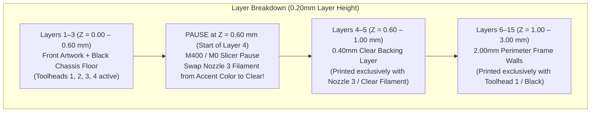

# 🖨️ Snapmaker U1 16x16 Matrix Plate 3D Printing Guide
## Main Street Electrical Parade (WDW 10K) Synchronized Costumes

This reference manual documents the slicing, toolhead mapping, layer pause workflow, and mechanical specs for printing **16x16 LED Matrix Faceplates** with a **0.4mm Clear Backing Layer**, **0.6mm Front Graphic Faceplate**, and **2.0mm Perimeter Frame (0.0mm Lip)** on the **Snapmaker U1 (4-Toolhead CoreXY Toolchanger)**.

---

## 1. Geometric & Mechanical Specifications

```
Total Z-Height:        3.00 mm (0.60mm Faceplate + 0.40mm Clear Backing + 2.00mm Frame Pocket)
Front Face Thickness:  0.60 mm (3 solid layers @ 0.20mm layer height)
Clear Backing Layer:   0.40 mm (2 solid layers @ 0.20mm layer height)
Total Panel Thickness: 1.00 mm (0.60mm Graphic + 0.40mm Clear Backing)
Perimeter Frame Wall:  2.00 mm width (outer footprint 164.4 x 164.4mm, 176 x 176mm plate with sewing tabs)
Pocket Cavity Depth:   2.00 mm full depth (Z = 1.00 to 3.00 mm)
LED Separation Lip:    0.0 mm (Strictly ZERO lip / zero shelf ledge; flat, open 160.4 x 160.4mm cavity)
Clear Backing Extent:  160.4 x 160.4 mm (Spans all the way flush to the inside walls of the 2mm frame)
Print Orientation:     FACE-DOWN on build plate (front graphic artwork against PEI textured sheet)
Chirality Standard:    Bed X-Mirroring (X_bed = 176.0 - X_front) ensures 100% un-mirrored front view when worn
```

---

## 2. Snapmaker U1 Toolhead Mapping & Color Strategy

The Snapmaker U1 features **4 physical direct-drive toolheads** (`T0`, `T1`, `T2`, `T3`). Because our costume badge artwork features multiple colors plus a clear diffuser layer, we leverage a single pause at **$Z = 0.60\text{ mm}$ (Layer 4)** on **Nozzle 3 / Toolhead 3 (T2 / Slicer Slot 3)**.

### Toolhead Assignment Table

| Toolhead / Slot | Hardware Nozzle | Pre-Print Filament | Post-Pause Filament ($Z \ge 0.60\text{ mm}$) | Printed Geometry |
| :--- | :--- | :--- | :--- | :--- |
| **Toolhead 1 (`T0`)** | Nozzle 1 | **Black PLA / TPU** | **Black PLA / TPU** | Front chassis outline ($Z=0..0.6$) & 2mm Frame ($Z=1..3$) |
| **Toolhead 2 (`T1`)** | Nozzle 2 | **Primary Artwork Color** *(e.g. Green)* | Parked | Float body / main contours ($Z=0..0.6$) |
| **Toolhead 3 (`T2`)** | **Nozzle 3** | **Accent Artwork Color** *(e.g. Magenta/Red)* | 🔄 **Clear PLA / TPU** *(Swapped at Pause)* | Front accents ($Z=0..0.6$) ➔ **0.4mm Clear Backing ($Z=0.6..1.0$)** |
| **Toolhead 4 (`T3`)** | Nozzle 4 | **Secondary Color** *(e.g. Yellow/Gold)* | Parked | Float belly / accents ($Z=0..0.6$) |

---

## 3. Z-Height Layer Progression (Face-Down Printing)



1. **Layers 1–3 ($Z = 0.00$ to $0.60\text{ mm}$):**
   - The panel prints face-down against the heated build plate.
   - Toolheads 1, 2, 3, and 4 print the crisp outlines and color inlays.
   - At $Z = 0.60\text{ mm}$, all front graphic artwork is completely finished.

2. **The Pause ($Z = 0.60\text{ mm}$, Layer 4):**
   - The printer triggers an automatic pause (`M400 \n M0`).
   - The toolhead parks, the machine chimes, and the touchscreen displays:
     `Pause: Change Nozzle 3 to Clear Filament`
   - Unload the accent spool from **Nozzle 3**, feed in your **Clear filament** (Clear PLA or 95A Clear TPU), purge a small bead into the waste container, and tap **Resume**.

3. **Layers 4–5 ($Z = 0.60$ to $1.00\text{ mm}$):**
   - **Nozzle 3** prints the $0.40\text{ mm}$ solid clear diffuser backing (2 solid layers at 90° cross-ply) across the entire $160.4 \times 160.4\text{ mm}$ cavity.
   - Windowed LED apertures (Ø 3.4mm) are preserved through both layers for maximum direct light output, while backlit positions receive smooth diffusion.

4. **Layers 6–15 ($Z = 1.00$ to $3.00\text{ mm}$):**
   - **Toolhead 1 (`T0`)** prints the $2.0\text{ mm}$ perimeter frame walls up to $Z = 3.00\text{ mm}$.
   - The interior cavity remains 100% open at $160.4 \times 160.4\text{ mm}$ with zero ledge lip.
   - Provides an exact **$2.0\text{ mm}$ of open depth** for the flexible BTF-LIGHTING 16x16 LED matrix to drop right in, seated flush against the clear backing!

---

## 4. Loading the 3MF Project in Snapmaker Orca / Bambu Studio

The exported 3MF project (`3d_panels/tpu_panel_front_multicolor.3mf`) comes pre-configured with multi-body assembly relationships and extruder mappings:

1. Launch **Snapmaker Orca** (or OrcaSlicer / Bambu Studio).
2. Select your printer: **Snapmaker U1 (0.4 nozzle)**.
3. Drag & drop `tpu_panel_front_multicolor.3mf` onto the build plate.
4. When prompted, select **"Load as single object with multiple parts"**.
5. Inspect the Objects Tree:
   - `1_Chassis_Black`: Extruder 1 (Toolhead 1)
   - `2_Dragon_Body`: Extruder 2 (Toolhead 2)
   - `3_Wings_and_Crest`: Extruder 3 (Toolhead 3)
   - `4_Belly_and_Horns`: Extruder 4 (Toolhead 4)
   - `Nozzle3_Clear_Backing_Layer_160x160`: **Extruder 3 (Toolhead 3)**
6. Check the Slicer Vertical Slider:
   - Move the layer slider to **Layer 4 ($Z = 0.60\text{ mm}$)**.
   - Right-click the layer bar ➔ Ensure a **Pause** (`M400` / `M0`) is placed at Layer 4.
7. Click **Slice plate** and send to your Snapmaker U1 over Wi-Fi or USB!

---

## 5. Recommended Slicer Print Settings

* **Infill Density:** **100% Solid Infill** (Mandatory for structural rigidity on race day, high mechanical tear resistance around corner KAM snap earlobes, and uniform light transmission).
* **Sparse Infill Pattern:** Monotonic / Rectilinear (or Aligned Rectilinear @ 100%).
* **Layer Height:** $0.20\text{ mm}$ (First Layer: $0.20\text{ mm}$).
* **Wall Loops:** 5 perimeter loops (ensures all frame walls, corner earlobes, and snap tabs print as solid concentric loops with zero hollow interior).
* **Top/Bottom Shells:** 15 bottom shell layers, 15 top shell layers (guarantees solid infill across the full 3.0mm plate height).
* **Build Plate:** Textured PEI Plate (creates a beautiful, professional matte anti-glare finish on the front float badge).
* **Bed Temperature:** $60^\circ\text{C}$ (PLA) or $50^\circ\text{C}$ (TPU).
* **Nozzle Temperature:** $210^\circ\text{C}$ (PLA) or $225^\circ\text{C}$ (TPU).
* **Speed:** 
  - First Layer: $40\text{ mm/s}$ (for pristine artwork line definition).
  - Outer Wall: $100\text{ mm/s}$.
  - Solid Infill: $150\text{–}200\text{ mm/s}$.
