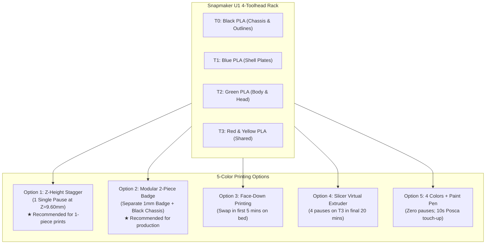

# 🖨️ Snapmaker U1 5-Color Printing Guide (100% PLA)
## Main Street Electrical Parade (WDW 10K) Synchronized Costumes

This reference guide documents the options, slicer strategies, and mechanical tradeoffs for printing **5-color costume panels** (Black Chassis + Blue, Green, Yellow, and Red float artwork) on the **Snapmaker U1 (4-Toolhead CoreXY Toolchanger)** using **100% PLA**.

---

## 1. Machine Architecture & Context

### Snapmaker U1 Toolchanger vs Bambu AMS
* **Snapmaker U1:**
  * **Architecture:** 4 independent direct-drive toolheads (`T0`, `T1`, `T2`, `T3`) parked on a tool rack.
  * **CoreXY Motion:** High-speed, high-precision print movement across a $270 \times 270 \times 270\text{ mm}$ build volume.
  * **Zero Purge Waste:** Tool changes switch physical toolheads in ~5 seconds without cutting filament, without 800mm Bowden retractions, and with **no purge tower / waste chute poop**.
  * **The Challenge:** The machine has **4 physical toolheads**, while our MSEP costume panels feature **5 colors** (Black chassis + 4 float artwork colors).

---

## 2. Geometry Inspection & Key Engineering Insights

Analyzing the front chest panel STLs (`3d_panels/tpu_panel_front_*.stl`):

```
tpu_panel_front_chassis_black.stl : Z = 0.00 to 10.00 mm (Total height: 10.0 mm)
tpu_panel_front_color_blue.stl    : Z = 9.20 to 10.00 mm (Height: 0.8 mm) -> 5.77 cm³
tpu_panel_front_color_green.stl   : Z = 9.20 to 10.00 mm (Height: 0.8 mm) -> 7.20 cm³
tpu_panel_front_color_yellow.stl  : Z = 9.20 to 10.00 mm (Height: 0.8 mm) -> 4.46 cm³
tpu_panel_front_color_red.stl     : Z = 9.20 to 10.00 mm (Height: 0.8 mm) -> 0.78 cm³ (Tiny tie & lips!)
```

### The Three Golden Realities:
1. **$92\%$ of the Print is 1 Single Color:** From $Z = 0.00\text{ mm}$ to $9.20\text{ mm}$ (~46 layers at $0.20\text{ mm}$ layer height), **ONLY BLACK** prints. Toolheads 1, 2, and 3 stay parked in their docks.
2. **Multi-Color Zone is Only 4 Layers Tall:** The 4 accent colors only exist from $Z = 9.20\text{ mm}$ to $10.00\text{ mm}$ ($0.8\text{ mm}$ total thickness).
3. **Red is Negligible Volume:** The red accents (`5_Tie_and_Lips` on the Turtle float) total only $0.78\text{ cm}^3$ (2,200 triangles), compared to Green ($7.20\text{ cm}^3$) and Blue ($5.77\text{ cm}^3$).

---

## 3. The 5 Strategy Options for 100% PLA



---

### Option 1: The "Z-Height Stagger" (1 Single Pause in Entire Print) — 🏆 *Best Monolithic Print*
* **Concept:** Two layers of PLA ($0.40\text{ mm}$) provide $100\%$ optical opacity. Red stops at $Z = 9.60\text{ mm}$ (layers 47 & 48), while Yellow prints on layers 49 & 50 ($Z = 9.60$ to $10.00\text{ mm}$).
* **Execution:**
  1. Load Toolhead 3 (`T3`) with **Red PLA** before starting the print.
  2. Hours 1–5 ($Z = 0.00$ to $9.20\text{ mm}$): Toolhead 0 prints Black unattended.
  3. At $Z = 9.20\text{ mm}$: `T0`, `T1`, `T2`, and `T3` (Red) print layers 47 & 48.
  4. At $Z = 9.60\text{ mm}$: Slicer triggers `PAUSE`. The printer parks, sounds an audible chime, and displays a prompt on the touchscreen.
  5. Unload Red from `T3`, feed in **Yellow PLA**, and tap Resume.
  6. Yellow prints layers 49 & 50 to complete the print.
* **Pros:** 
  * Only **one** manual intervention in a 6-hour print.
  * No multi-color waste tower.
  * Subtle $0.4\text{ mm}$ relief depth on red details adds a molded Disney enamel pin appearance.

---

### Option 2: Modular 2-Piece Assembly — 🏆 *Imagineering Production Standard*
* **Concept:** Decouple the structural $10\text{ mm}$-thick Black chassis from the decorative float emblem.
* **Execution:**
  1. **Black Chassis:** Sliced as a pure black PLA housing with a $1.2\text{ mm}$ recessed badge pocket. Prints unattended on `T0` at 250+ mm/s CoreXY speed.
  2. **Float Emblem Badge:** Sliced as a separate $1.0\text{ mm}$ plate. Printed either as a 4-color plate with black negative space, or 5-color with 1 pause on a small 20-minute print.
  3. **Assembly:** Drops into the chassis pocket and bonds with medium cyanoacrylate (CA glue) or mechanical perimeter snap-tabs.
* **Pros:**
  * **Failure Isolation:** If a nozzle strings or filament snarls on the 5-color badge, you lose a 15-gram, 20-minute piece—not a 250-gram, 6-hour chassis!
  * **Fleet Modularity:** Emblems can be customized or swapped across runner costumes without reprinting main housings.

---

### Option 3: Face-Down First-Layer Printing (Front-Loaded Swap)
* **Concept:** Slice the model face-down so the artwork prints directly against the heated PEI bed on layers 1–3 ($Z = 0.00$ to $0.60\text{ mm}$).
* **Execution:**
  1. Multi-color action happens immediately on layers 1–3.
  2. Any manual swap on `T3` between Red and Yellow happens in the **first 5 minutes** of the print while watching the skirt/first layer.
  3. Once layer 3 completes, you walk away: `T0` prints the remaining $9.4\text{ mm}$ of black chassis completely unattended.
* **Pros:**
  * Flawless first-layer textured or satin PEI surface finish (zero visible layer lines on the graphic).
  * You don't have to wait 5 hours for the pause—it happens immediately at the start.

---

### Option 4: Slicer Virtual Extruder (4 Swaps in the Final 20 Minutes)
* **Concept:** Set up 5 extruders in OrcaSlicer, mapping Extruders 4 and 5 to share physical Toolhead 3 (`T3`).
* **Execution:**
  * During the top 4 layers ($Z = 9.20$ to $10.00\text{ mm}$), `T3` prints Red, triggers `PAUSE`, you swap to Yellow, `T3` prints Yellow.
  * Total swaps: 1 swap/layer $\times$ 4 layers = **4 manual filament swaps**.
* **Pros:** Both Red and Yellow span the full $0.80\text{ mm}$ top depth flush with all other colors.

---

### Option 5: 4-Color Native Print + 10-Second Paint Pen Touch-Up
* **Concept:** Consolidate the model into **4 colors** natively supported by the 4 toolheads (`T0` Black, `T1` Blue, `T2` Green, `T3` Yellow or White).
* **Execution:**
  * Print runs $100\%$ unattended from start to finish with zero pauses.
  * Post-print, take a red **Posca acrylic paint pen** or oil-based paint marker and color the raised tie and lips.
* **Pros:** Zero pauses, zero filament swaps, zero slicer tricks. Acrylic paint adheres tenaciously to PLA layer lines and takes 10 seconds.

---

## 4. Slicer & Thermal Configuration (OrcaSlicer / Klipper)

### Toolhead Allocation Table
| Toolhead | Physical Slot | Assigned Material | Role in Print |
| :---: | :---: | :--- | :--- |
| **`T0`** | Tool 1 | PLA Black | Chassis housing, internal ribs, outlines |
| **`T1`** | Tool 2 | PLA Blue | Shell plates, spectacles, blue accents |
| **`T2`** | Tool 3 | PLA Green | Character body, shell base, scales |
| **`T3`** | Tool 4 | PLA Red $\rightarrow$ Yellow | Shared accent toolhead (paused at $Z=9.60\text{ mm}$) |

### Parked Toolhead Thermal Management
To prevent PLA from drooling while parked or suffering heat creep in the inactive heads:
```gcode
; In OrcaSlicer -> Printer Settings -> Custom G-code -> Tool Change G-code
M104 T[current_extruder] S210 ; Set active toolhead to 210°C
M104 T[previous_extruder] S175 ; Drop parked toolhead to 175°C standby (prevents PLA cooking/drool)
```

### Manual Pause Macro (Klipper / OrcaSlicer)
```gcode
; In OrcaSlicer -> Layer Change G-code
{if layer_z == 9.60}
PAUSE
M300 S1000 P500 ; Audible chime
; LCD prompt: "Swap Toolhead 3 from Red to Yellow PLA, then press Resume"
{endif}
```

---

## 5. Ergonomics & Weight Considerations for 100% PLA

Because PLA is rigid (unlike rubbery TPU), keep these parameters in mind for the race costumes:

1. **Weight Optimization:**
   * **Infill:** Use $10\%$ to $12\%$ Gyroid infill. Do not print solid 100% infill.
   * **Walls:** 2 or 3 perimeters ($0.8\text{ mm}$ to $1.2\text{ mm}$ wall thickness).
   * **Target Weight:** Keeps the $240 \times 212\text{ mm}$ chest plate under $\sim 170\text{ grams}$ per runner.
2. **Mounting to Race Shirts:**
   * Because PLA cannot bend around torso curvature, mount using:
     * 4-corner **BibBoards snap fasteners** (compatible with the 16 perimeter eyelet tabs already designed into the chassis).
     * Hook-and-loop (Velcro) patches stitched to the technical shirt chest.
     * Lightweight elastic torso harness.

---

## 6. Next Steps Checklist (When Ready to Decide)

- [ ] Select preferred strategy (**Option 1** for 1-piece print vs **Option 2** for modular badge).
- [ ] If Option 1: Adjust STL height of `tpu_panel_front_color_red.stl` to $0.40\text{ mm}$ (ending at $Z = 9.60\text{ mm}$) or slice with layer-range modifier.
- [ ] If Option 2: Export standalone $1.0\text{ mm}$ emblem plate and hollow chassis pocket.
- [ ] Run a $50 \times 50\text{ mm}$ 5-color calibration swatch on the Snapmaker U1 to verify tool docking, standby temperatures, and pause chime.
