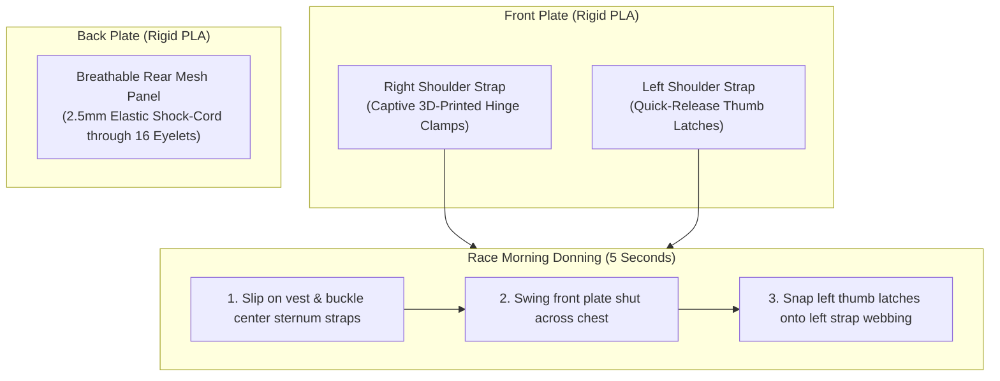

# 🎽 SWIFTVEST Mounting & Attachment Guide (100% PLA Plates)
## Main Street Electrical Parade (WDW 10K) Costumes

This guide provides the complete mechanical engineering, donning/doffing workflow, and battery routing specifications for securing the $240.4 \times 212.4 \times 10.0\text{ mm}$ rigid PLA front and back costume panels to the **SWIFTVEST running vest** ([Amazon ASIN B0CGPYLG6H](https://www.amazon.com/dp/B0CGPYLG6H)).

---

## 1. System Overview: Non-Destructive Hinge & Bungee Mount

Because the SWIFTVEST opens down the center sternum for donning/doffing, and our front PLA plate spans $240\text{ mm}$ ($9.5\text{ inches}$) across both shoulder straps, the system utilizes a **"Hinged Book-Style" quick-release mechanism**:



---

## 2. Interactive 3D Assembly & Visual Inspection

We have provided two dedicated 3D visualization tools in your workspace:

1. 🌐 **Interactive 3D Browser Viewer:** Open [`simulator/swiftvest_assembly_viewer.html`](file:///c:/Users/Kiddi/Desktop/WDW%20costumes/simulator/swiftvest_assembly_viewer.html) in any browser (Chrome, Edge, Safari). It features:
   * **Full 360° Orbit & Zoom:** Inspect every angle of the vest, plate, and mounting clips.
   * **Interactive "Swing Door" Slider ($0^\circ \leftrightarrow 110^\circ$):** Watch the front plate swing open like a car door on the right hinge, revealing the center sternum buckles underneath.
   * **Exploded View Slider ($0 \leftrightarrow 80\text{ mm}$):** Separate the vest, mounting clips, and plate along the Z-axis to see exactly how each layer mates.
2. 🧊 **Assembled 3D STL Model:** Open [`3d_panels/swiftvest_front_assembly_preview.stl`](file:///c:/Users/Kiddi/Desktop/WDW%20costumes/3d_panels/swiftvest_front_assembly_preview.stl) in OrcaSlicer, Bambu Studio, or Windows 3D Viewer to inspect the complete physical fit.

---

## 3. Illustrated Schematics: How the Assembly Works

### Front Elevation View (Race Mode — Latched Closed Across Chest)
```text
                  [ RUNNER'S NECK / COLLAR ]
                   /                      \
                  /   [SWIFTVEST HARNESS]  \
                 /                          \
        +-------+----------------------------+-------+
        | LEFT  |                            | RIGHT |
        | STRAP |    240mm RIGID PLA PLATE   | STRAP |
        | (Web) |    (Chest / Character Art) | (Web) |
        |       |                            |       |
        | [LATCH]============================[HINGE] |  <-- Hinge stays pinned to right strap
        |  (Red)|       [TURTLE / DRAGON]    | (Gold)|  <-- Latches snap onto left strap
        |       |                            |       |
        | [LATCH]============================[HINGE] |
        |       |                            |       |
        +-------+----------------------------+-------+
         \     /                              \     /
          \   /     [CENTER STERNUM STRAPS]    \   /
           \ /       (Hidden Behind Plate)      \ /
            V                                    V
```

### Top-Down Cross-Section View (Looking Down from Chin)
```text
1. RACE MODE (CLOSED & LOCKED):
   Left Strap                                            Right Strap
   [ WEBBING ]                                           [ WEBBING ]
        |                                                     |
     [LATCH] <--(Snapped Shut)                       (Hinged) [HINGE]
        |                                                     |
     ==============================================================
                      240mm RIGID 3D PLA PLATE (FRONT)

2. DONNING / DOFFING MODE (SWUNG OPEN LIKE A CAR DOOR):
   Left Strap                                            Right Strap
   [ WEBBING ]                                           [ WEBBING ]
        |                                                     |
     (Open)                                          (Hinged) [HINGE]
                                                              \
        [ UNBUCKLE STERNUM STRAPS HERE! ]                      \
             (Vest opens to take off)                           \  240mm FRONT PLATE
                                                                 \  SWUNG OPEN 110°!
                                                                  \
                                                                 [LATCHES]
```

---

## 4. Front Plate Mounting: "Book-Style" Hinge Action

* **Right Shoulder Strap (Permanent Pivot Hinge):**
  * Two 3D-printed captive hinge brackets (`swiftvest_hinge_clamp_right.stl`) screw into the right-hand perimeter eyelets using M2 hardware into the existing chassis pilot bosses.
  * The brackets clamp around the vertical webbing track of the right shoulder strap.
  * The front plate remains permanently attached to the right strap, swinging freely like a book door.
* **Left Shoulder Strap (Quick-Release Snap Latch):**
  * Two 3D-printed thumb latches (`swiftvest_quick_latch_left.stl`) mount to the left-hand eyelets.
  * **Closing:** Simply press against the left shoulder strap webbing until you hear a crisp, tactile mechanical click.
  * **Opening:** Press the thumb tab on the left latches with one hand $\rightarrow$ swing the plate open to the right $\rightarrow$ unbuckle the SwiftVest sternum straps $\rightarrow$ step out. Total time: $< 5\text{ seconds}$.

---

## 3. Back Plate Mounting: Dynamic Elastic Bungee

* **Non-Destructive Mesh Anchor:**
  * Thread $2.5\text{ mm}$ marine-grade elastic shock-cord through the back plate's 16 perimeter eyelets and weave it through the SWIFTVEST's rear breathable mesh.
  * Cinch tightly using two low-profile barrel cord-locks.
* **Why Bungee is Superior to Rigid Screws on the Back:**
  * Running generates cyclical spine curvature and thoracic expansion. Bungee cord allows $15\text{--}20\text{ mm}$ of dynamic breathing compliance while firmly holding the plate flush against the back without vertical bounce or slap.

---

## 4. Power Bank Housing: Waist Belt vs Front Chest Pocket

```
+-------------------------------------------------------------------------------------------------+
|                                BATTERY HOUSING COMPARISON MATRIX                                |
+--------------------------+------------------------------------+---------------------------------+
| Feature                  | Option A: Front Chest / Flask Pkt  | Option B: Running Waist Belt    |
+--------------------------+------------------------------------+---------------------------------+
| Location                 | Lower elastic flask pocket on vest | Separate belt (FlipBelt/SPIbelt)|
| Weight Distribution      | On chest/shoulders (~150-200g bank)| On hips / pelvis (Center of G)  |
| Perceived Bounce         | Low-to-moderate inside vest pocket | Zero (stabilized around hips)   |
| On-the-Fly Accessibility | Immediate (reach down to rib pocket)| Easy (reach to waist)          |
| Wire Routing Length      | Short (~15-20cm to bottom portal)  | Medium (~40-50cm up side/back)  |
| Extra Gear Required      | None (uses built-in vest pocket)   | 1 running waist belt per runner |
+--------------------------+------------------------------------+---------------------------------+
```

### Imagineering Recommendation:
* **Option A (Front Flask Pocket):** Ideal if runners use slim, compact $5000\text{ mAh}$ power banks (e.g. cylindrical 21700 or ultra-thin card style). Requires no extra accessories; plugs straight into the bottom wire entrance portal with a short 6-inch cable.
* **Option B (Running Waist Belt):** Ideal if runners use standard rectangular $10,000\text{ mAh}$ battery bricks ($>200\text{ grams}$). Shifting the heaviest component to the hips dramatically improves running form and eliminates all bounce over 6.2 miles.

---

## 5. Wiring & Cable Routing Architecture


1. **Strain Relief Bridge:** Both the front and back plates feature internal $8 \times 7.2\text{ mm}$ 3D strain relief bridges behind the portals. Power and data wires are zip-tied internally to guarantee that race-day cord tugs never stress the soldered pixel joints.
2. **Quick-Disconnect Connector:** An inline 3-pin JST-SM or magnetic pigtail connects the front plate to the back plate over the left shoulder, allowing the plates to be unplugged for transport and washing of the vest.
